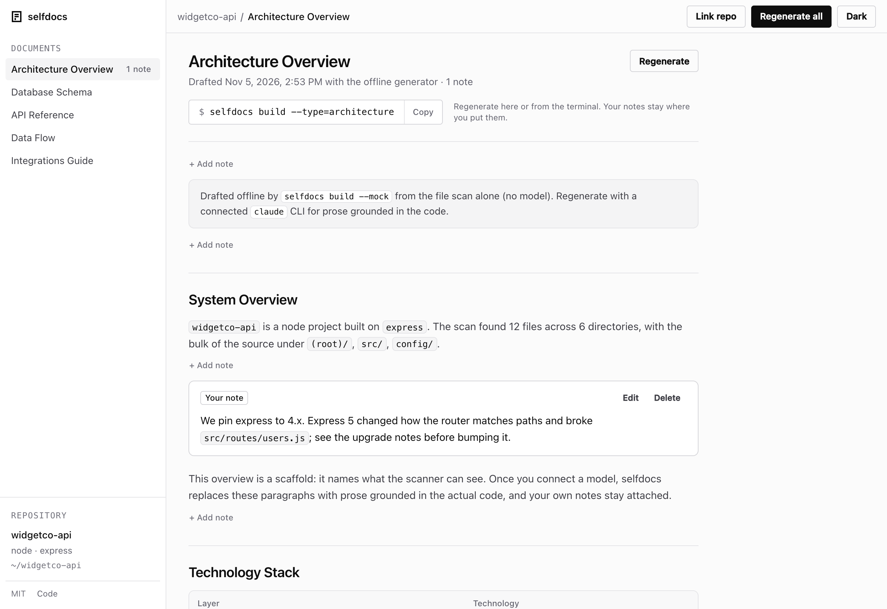

# selfdocs

Scans a repo and drafts five architecture docs with your local `claude` CLI, then serves them in a viewer. Your
own notes survive every regeneration.



Regenerating a doc from scratch throws away the one thing worth keeping: the note someone wrote about why
express is pinned to 4.x. selfdocs splits each doc into anchored blocks and pins your notes to them, so
regenerating updates the draft and leaves your notes where you put them.

## Install

Needs Node 20 or later. No runtime dependencies.

```sh
npm i -g @excellent-so/selfdocs    # adds a `selfdocs` command
```

Or run it without installing, with `npx @excellent-so/selfdocs <command>`, or pin it in a project with
`npm i -D @excellent-so/selfdocs`.

## Quick start

In the repo you want documented:

```sh
npx @excellent-so/selfdocs build --mock   # scan the repo and draft all five docs, offline
npx @excellent-so/selfdocs open           # serve the viewer and open it in your browser
```

`--mock` needs nothing else installed. To have the model write the docs, install the `claude` CLI, sign in, and
build without it:

```sh
npx @excellent-so/selfdocs build
```

The viewer runs at http://127.0.0.1:4630. In it you can read each doc, add a note under any paragraph, list,
table or code block, link a different repo, and generate again.

### From a clone

```sh
git clone https://github.com/excellent-so/selfdocs.git
cd selfdocs
node bin/selfdocs.mjs build --mock --target=fixture
node bin/selfdocs.mjs open --target=fixture
```

That documents `fixture/`, a small Express app the tests use.

## What it does

1. **Scans** the repo into a manifest of files with content hashes. It honours `.gitignore` and detects the
   project type, framework, test runner, CI and package manager.
2. **Drafts** five docs: architecture, schema, API, data flow and integrations. For each one it picks the files
   that match that doc's patterns and passes them to the `claude` CLI with a directory tree of the repo.
3. **Checks** the markdown: one H1, the sections each doc needs, balanced code fences, tables with alignment rows,
   heading levels in order. It repairs what it can and asks the model to fix the rest, up to twice.
4. **Keeps your notes.** Each doc is split into blocks, and each block is anchored by its heading path. A note is
   pinned to the block above it. On a regeneration, drafted blocks update in place and notes stay with their
   anchors. If a section disappears, its notes move to a list of detached notes at the end of the doc, and each
   goes back in place if its section returns.
5. **Serves** the viewer: one HTML file with no external requests, on 127.0.0.1.

## Commands

| Command | What it does |
|---|---|
| `selfdocs build` | Scan the repo and draft its docs into `.selfdocs/` |
| `selfdocs build --mock` | The same, with the offline generator: no CLI, no network |
| `selfdocs build --type=architecture,api` | Only these doc types |
| `selfdocs serve` | Serve the viewer |
| `selfdocs open` | Serve the viewer and open it in your browser |
| `selfdocs status` | What's drafted, with block and note counts |
| `selfdocs doctor` | Check the `claude` CLI, the config and what the repo was detected as |
| `selfdocs init` | Write a starter `selfdocs.config.mjs` |

Every command except `init` takes `--target=DIR`, the repo to document (default: the current directory, or the
directory of the nearest config file). `build` also takes `--ignore=a,b` for extra ignore patterns and
`--model=NAME`. `serve` and `open` listen on port 4630; set `PORT` or pass `--port=N` to change it. If the port is
taken they try the next one, up to 25 ports higher.

The doc types are `architecture`, `schema`, `api`, `data-flow` and `integrations`.

## Configuration

Every key is optional. selfdocs looks for `selfdocs.config.mjs`, `.js`, `.cjs` or `.json` in the current
directory and the ones above it. `selfdocs init` writes a starter file:

```js
// selfdocs.config.mjs
export default {
  // The repo to document, relative to this file. Default: this directory.
  target: ".",

  // Extra .gitignore-style patterns, on top of the built-in defaults and your .gitignore.
  ignore: ["examples/**", "*.generated.ts"],

  // Which doc types to generate. Default: all five.
  docTypes: ["architecture", "schema", "api", "data-flow", "integrations"],

  // The model passed to the claude CLI (ignored with --mock).
  model: "claude-sonnet-4-6",
};
```

Environment variables: `SELFDOCS_TARGET` (the repo to document), `SELFDOCS_CLAUDE_BIN` (the `claude` binary to
run) and `PORT` (the viewer's port).

## Where the output goes

Everything is written to `.selfdocs/` in the repo being documented, as plain JSON:

```
.selfdocs/
  manifest.json            the latest scan: files, hashes, detected stack
  docs/architecture.json   drafted blocks and your notes, each anchored
  docs/schema.json
  docs/api.json
  docs/data-flow.json
  docs/integrations.json
```

Add `.selfdocs/` to `.gitignore` to keep it out of version control. To keep your notes in version control,
commit `.selfdocs/docs/` and ignore `.selfdocs/manifest.json`.

## Limits

- **Real drafts need the `claude` CLI**, installed and signed in, on your `PATH` or at `SELFDOCS_CLAUDE_BIN`.
  Without it, `selfdocs build` stops and suggests `--mock`, and the viewer's Generate button uses the offline
  generator.
- **A real draft sends code to the model.** The files selfdocs picks go to the model through your `claude` CLI,
  under your Claude account. Values in `.env` files are replaced with `<redacted>` first; `.env.example` and
  `.env.sample` are sent as they are. The CLI runs with every tool disabled, so the model sees only what selfdocs
  sends.
- **Large repos are read in part.** Each doc gets an estimated 80,000 tokens of source (320,000 characters),
  and any one file is cut at 50,000 characters. A doc reads its closest-matching files first, then looser
  matches, until that budget runs out. If the model says the context is too large, selfdocs retries once with
  half.
- **The checks cover structure.** They don't check facts. Read the drafts against the code and put corrections
  in notes.
- **`--mock` drafts from the file scan alone**: file paths, file counts per directory and the detected stack.
  It doesn't read your code for meaning, so its docs are scaffolds that name what the scanner saw and say what
  it couldn't infer. It's there to try selfdocs, and for tests and CI.
- **The five doc types are fixed.**
- **The viewer has no login.** It listens on 127.0.0.1 only and refuses writes from other origins. It's meant for
  your own machine.

## Development

```sh
npm test                  # the test suite: offline, no dependencies
npm run test:standalone   # build --mock from the published files with HOME, PATH and the environment stripped
```

The viewer's look comes from [@excellent-so/kit](https://github.com/excellent-so/kit), written into
`viewer/index.html` between the `excellent-kit` markers. See [CONTRIBUTING.md](./CONTRIBUTING.md).

## License

MIT. See [LICENSE](./LICENSE).
